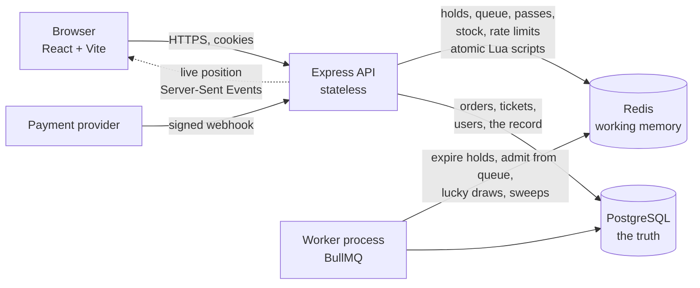

# Flash-Sale Ticketing System

[](https://github.com/ManishRatan17/Ticket-Booking/actions/workflows/test.yml)

**300 tickets. 10,000 people pressing "buy" at the same second. Nobody gets a ticket that doesn't exist, the server doesn't fall over, and the order is fair.**

A full-stack ticketing platform built around one hard problem: selling a small number of tickets to a huge crowd **correctly** and **fairly**. Built step by step as a learning project, with every decision, trade-off and measurement written down in [docs/](docs/README.md).

## Measured, not claimed

Load-tested with [k6](https://k6.io) against the real system (Linux containers, rate limits and bot strikes on), then **checked with SQL**:

| Scenario | People | Requests | Failed | Median | p95 | Result (verified in PostgreSQL) |
|---|---|---|---|---|---|---|
| **Waiting room** (the real design): join, wait, buy (hold → order → pay) | 10,000 | 32,979 | **0** | **3 ms** | **48 ms** | exactly **300 sold**, ticket numbers 1–300, no duplicates, 150 paid orders |
| **No waiting room**, 500 clicks a second (worst case) | 10,000 | 9,982 | **0** | 6 ms | 327 ms | exactly **300 held**, 0 oversold |
| **No waiting room**, 1,000 clicks a second (beyond one laptop process) | 10,000 | 7,761 answered | **0** | 145 ms | 6.8 s | exactly **300 held**, 0 oversold |

Never oversold in any run, including the first one, before the bottlenecks it found were fixed. The load test exposed a database bottleneck on the hot path (790 errors in the first run → **0**, throughput **×1.9**). Details, before/after numbers and honest limits: [docs/19-load-testing.md](docs/19-load-testing.md).

**419 automated tests** (378 server tests against real PostgreSQL and Redis, 41 client tests with Vitest), with **mutation testing**: every important protection was deliberately broken to prove a test catches it. They run on every push (GitHub Actions, real PostgreSQL and Redis), against their own test database.

## How it works



**The core rule: Redis is the working memory, PostgreSQL is the record. If they disagree, PostgreSQL wins**, and Redis can always be rebuilt from it.

| Problem | How it's solved |
|---|---|
| **Two people buying the last ticket** | the check and the take happen in **one atomic Redis Lua script**; PostgreSQL `CHECK (tickets_sold <= total)` + `UNIQUE (event, ticket number)` as a second safety net |
| **10,000 people at once** | a **waiting room**: everyone gets a place in line instantly; a worker lets N people per second through to buy. The crowd costs cheap Redis reads; the buying step sees a steady load |
| **Fair order** | the lobby opens before the sale; everyone in it gets a **random** place when the sale opens (clicking at the exact second gains nothing); later arrivals queue behind |
| **"What are my chances?"** | live position, estimated wait, and a good / maybe / unlikely level from tickets left |
| **Lucky draw** | an admin can set aside up to 50 % of tickets for a **provably fair draw** among everyone waiting (commit–reveal: the seed's SHA-256 is published before the draw; anyone can verify their number in the browser) |
| **Abandoned checkouts** | holds expire after 5 minutes; a background worker releases them, with retries and a dead-letter queue |
| **Double clicks, retries, duplicate webhooks** | idempotency keys on orders; processed-webhook ids; one transaction per payment |
| **Payments** | Razorpay (test mode): the server creates the Razorpay order, checks the payment signature, and Razorpay's signed webhook is the backup; both go through one idempotent transaction |
| **Late payment after the hold expired** | confirm if tickets are still available, otherwise fail and refund |
| **Bots and scalpers** | per-user and per-IP rate limits, a 4-ticket cap per person per event, Cloudflare Turnstile, a hidden honeypot, and **bot strikes**: 1st → booking paused 15 days, 2nd within a year → banned, with appeals |
| **Accounts** | argon2id passwords, JWT in HttpOnly cookies with rotating refresh tokens and reuse detection, Google sign-in (OIDC + PKCE), CSRF protection, password reset |

## Features

- **Buyers:** browse events, waiting room with live position, hold up to 4 tickets with a countdown, checkout, My orders with ticket numbers, lucky-draw entry and "verify the draw", Help (ask for more tickets, appeal a restriction)
- **Admins:** Manage events with live numbers (sold, held, left, revenue, queue) and editing; Support inbox (approve "more tickets"); Restrictions with bot-strike notifications; Users and roles; System health (background worker, failed jobs with Retry). Admins can't buy tickets themselves.

## Tech stack

**Backend:** Node.js 24, Express 5, PostgreSQL 16, Redis 7 (Lua scripts, sorted sets), BullMQ, zod, argon2, jose (JWT) · **Frontend:** React 19, React Router, Vite · **Testing:** node:test, Vitest, k6 · **Infrastructure:** Docker Compose, a Docker image for the API

## Run it locally

Needs Node.js 20.6+ and Docker Desktop.

```powershell
docker compose up -d                       # PostgreSQL + Redis
npm install
copy server\.env.example server\.env       # then set JWT_ACCESS_SECRET (see the file)
npm run migrate
npm run seed:demo                          # optional: demo events (one with a waiting room, one with a lucky draw)
npm run dev                                # API + worker + React → http://localhost:5173
```

Make yourself an admin: `npm run set-role -- you@example.com admin` (then log out and in). Tests: `npm test`. Load test: [docs/19](docs/19-load-testing.md#run-it-yourself). **Deploy:** one Docker image (API + website + worker), step by step in [docs/21](docs/21-deployment.md).

## Documentation

Everything is in [docs/](docs/README.md): architecture, every table and Redis key, authentication, security, the waiting room, payments, background jobs, protection, the lucky draw, load testing, the API reference, the testing approach, and a log of every decision and the options rejected.

## Honest limits

- Load-tested on one laptop with one API process; the API is stateless, so it scales out behind a load balancer, but that's not measured yet. 10,000 simultaneous live-update connections weren't tested.
- Payments: **Razorpay test mode** when keys are set (tested against a fake Razorpay; not yet tried with real test keys), otherwise a built-in fake provider. Emails go through Resend in production and are printed to the console in development.
- Styling is deliberately minimal for now.
- Out of scope: seat maps, a refunds UI, multi-region, a mobile app, real money.
